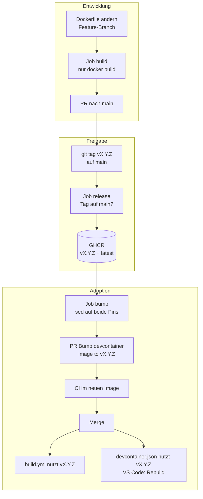

# Konzept: Versionierung und Continuous Deployment des DevContainers

Auftrag 3 · Stand: 16.09.2026 · Repository: <https://github.com/Flashbibi/450-tictactest-mvk>

Dieses Dokument hält die Entwurfsentscheidungen fest. Die operative Beschreibung – wie eine Freigabe konkret abläuft – steht in [`DEVCONTAINER.md`](DEVCONTAINER.md).

## Ausgangslage

Nach Auftrag 1 und 2 existiert ein Alpine-Image mit Java 25 in der GitHub Container Registry, und die CI läuft darin. Der Stand hat aber zwei Schwächen:

- `devcontainer-image.yml` pusht bei **jeder** Änderung an `.devcontainer/` von **jedem** Branch auf `:latest`
- `build.yml` zieht `:latest`

Ein fehlerhaftes Dockerfile auf einem Feature-Branch überschreibt damit sofort das Image, mit dem `main` gebaut wird. Es gibt keinen Unterschied zwischen „gebaut" und „freigegeben".

## Anforderungen aus dem Auftrag

| # | Anforderung | Kurzform |
|---|---|---|
| A1 | Image nach automatischem Build und Push automatisch in CI **und** lokal verwenden | Auto-Adoption |
| A2 | Sinnvoll versionieren, z.B. `v1.0.0`, `v1.0.1` | Versionierung |
| A3 | Verhindern, dass nicht freigegebene Container verwendet werden | Freigabe-Sperre |
| A4 | Bei erfolgreichem Push automatisch einen PR erstellen, der die neue Version nutzt | Bump-PR |
| A5 | Alle CI-Jobs nutzen automatisch die neueste Version | CI-Adoption |
| A6 | Lokale Umgebungen nutzen automatisch die neueste Version | Lokale Adoption |
| A7 | Gesamten Prozess in Markdown dokumentieren | Doku |

## Das Spannungsfeld

A1, A5 und A6 verlangen *„automatisch die neueste Version"*. A3 verlangt *„nur freigegebene Versionen"*. Beides gleichzeitig geht nur, wenn klar definiert ist, was „neueste" heisst: **die neueste freigegebene Version, nicht der neueste Build.**

A4 liefert den Mechanismus dafür: die Automatik eröffnet einen PR, ein Mensch merged ihn. Der Merge ist die Adoption. Damit ist „automatisch" erfüllt – die Umstellung passiert ohne Handarbeit am Code – und „freigegeben" auch, weil nichts ohne Review in Betrieb geht.

## Leitfragen und Entscheidungen

### 1. Wie wird versioniert?

**SemVer als Git-Tags `vMAJOR.MINOR.PATCH`.**

| Stelle | Erhöhen wenn |
|---|---|
| MAJOR | Base-Image oder Java-Version wechselt – bestehende Umgebungen können brechen |
| MINOR | Tools oder Extensions kommen dazu, Bisheriges läuft weiter |
| PATCH | Korrektur ohne neue Funktion |

Git-Tags statt einer Versionsdatei im Repository, weil ein Tag unveränderlich an einen Commit gebunden ist. Man sieht jederzeit, welcher Dockerfile-Stand zu welcher Image-Version gehört.

### 2. Was ist eine Freigabe?

**Ein Tag `v*` auf einem Commit, der auf `main` liegt.**

Der Tag ist die Freigabe – nicht der Merge, nicht der Build. Ein Merge nach `main` ändert das Dockerfile, erzeugt aber kein Image. Erst der Tag löst den Build aus. So kann man mehrere Änderungen auf `main` sammeln und gemeinsam freigeben.

### 3. Wie wird verhindert, dass nicht freigegebene Images verwendet werden?

Drei Sperren, die unabhängig voneinander wirken:

| Sperre | Verhindert |
|---|---|
| Branch-Pushes bauen das Dockerfile nur, pushen aber nichts | Ein nicht freigegebener Build erreicht das Registry gar nicht |
| Der Release-Job prüft `git merge-base --is-ancestor <Tag> main` | Ein Tag auf einem Feature-Branch bricht ab – nur `main` gibt frei |
| CI und `devcontainer.json` verweisen auf eine feste Version, nie auf `latest` | Selbst ein von Hand gepushtes Image wird nirgends benutzt, bis ein PR den Pin ändert |

Die dritte Sperre ist die entscheidende. Sie macht das Registry zu einem passiven Ablageort: was dort liegt, ist erst dann in Betrieb, wenn das Repository darauf zeigt.

### 4. Wie kommt eine neue Version in die CI?

**Über den Bump-PR.** Nach dem Push des Images ersetzt der Workflow die Versionsnummer in `build.yml` per `sed` und eröffnet einen PR. Die CI dieses PRs läuft bereits im neuen Image – der grüne Haken beweist, dass es funktioniert. Der Merge stellt alle Jobs um.

Kein Auto-Merge: der PR ist bewusst der Punkt, an dem ein Mensch hinschaut.

### 5. Wie kommt eine neue Version lokal an?

**Derselbe Bump-PR ändert auch `devcontainer.json`.** Die Datei referenziert das Image direkt (`"image": "ghcr.io/…:v1.0.0"`) statt lokal aus dem Dockerfile zu bauen. Ändert sich der Pin, erkennt VS Code beim nächsten Öffnen die geänderte Konfiguration und bietet *Rebuild Container* an.

Das ist automatischer als `latest`: bei `latest` würde VS Code das lokal gecachte Image weiterverwenden und nie von selbst neu pullen. Ein geänderter Tag hingegen erzwingt den Pull.

### 6. Was löst was aus?

| Ereignis | Job | Ergebnis |
|---|---|---|
| Push auf Branch, `.devcontainer/` geändert | `build` | `docker build`, kein Push |
| Push eines Tags `v*` | `release` | Prüfung, Build, Push `vX.Y.Z` + `latest` |
| `release` erfolgreich | `bump` | PR mit neuen Pins |
| Bump-PR gemerged | `build.yml` | CI läuft im neuen Image |
| Repository lokal geöffnet | VS Code | Rebuild-Hinweis, Pull des neuen Images |

### 7. Welche Rolle hat `latest`?

**Alias auf die neueste Freigabe, ohne Konsumenten.** Das Tag wird bei jeder Freigabe mitgesetzt, damit ein `docker pull` ohne Versionsangabe etwas Sinnvolles liefert. Nichts im Repository verweist darauf.

## Architektur

## Betrachtete Alternativen

**`latest` überall, nur Freigaben pushen `latest`.** Erfüllt A3, aber nicht A4 – es gäbe nichts, was ein PR ändern könnte. Und lokal bleibt das Problem aus Frage 5: VS Code pullt `latest` nicht von selbst.

**Auto-Merge des Bump-PRs.** Wäre „noch automatischer", nimmt aber den einzigen Punkt weg, an dem jemand das neue Image im Betrieb sieht, bevor es überall gilt. Der Auftrag verlangt einen PR, keinen Merge.

**Renovate oder Dependabot** für die Pins. Können Image-Tags in Dockerfiles aktualisieren, aber nicht zuverlässig `container: image:` in Workflows und `devcontainer.json` gleichzeitig. Ein eigener `sed`-Schritt ist kürzer und vollständig nachvollziehbar.

**Branch-Builds mit `sha-<commit>` ins Registry pushen.** Erlaubt, ein Image vor der Freigabe in der CI zu testen. Verworfen, weil damit nicht freigegebene Images im Registry liegen – der Auftrag will genau das vermeiden. Der Preis: ein kaputtes Image fällt erst beim Bump-PR auf und wird mit einem Patch-Release korrigiert.

## Bekannte Einschränkungen

**PRs aus `GITHUB_TOKEN` lösen keine Workflows aus.** GitHub verhindert so Endlosschleifen. Der Bump-PR hätte damit keine CI. Lösung: ein Fine-grained PAT als Secret `DEVCONTAINER_PR_TOKEN`; der Workflow fällt ohne Secret auf `GITHUB_TOKEN` zurück, dann muss die CI von Hand angestossen werden.

**Das Package ist privat.** Wer `devcontainer.json` lokal nutzt, braucht einmalig `docker login ghcr.io` mit `read:packages`. Alternativ das Package auf public stellen.

**Die erste Version muss von Hand entstehen.** `v1.0.0` wird manuell gebaut und gepusht, weil der PR, der die Pins einführt, das Image bereits zum Ziehen braucht. Ab `v1.0.1` läuft alles über den Workflow.
