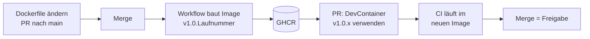

# Konzept: Versionierung und Continuous Deployment des DevContainers

Auftrag 3 · Stand: 26.10.2026 · Repository: <https://github.com/Flashbibi/450-tictactest-mvk>

Dieses Dokument hält die Entscheidungen fest. Wie eine neue Version konkret entsteht, steht in [`DEVCONTAINER.md`](DEVCONTAINER.md).

## Ausgangslage

Nach Auftrag 1 und 2 existiert ein Alpine-Image mit Java 25 in der GitHub Container Registry (GHCR), und die CI läuft darin. Der Stand hatte zwei Schwächen:

- `devcontainer-image.yml` pushte bei **jeder** Änderung an `.devcontainer/` von **jedem** Branch auf `:latest`
- `build.yml` zog `:latest`

Ein fehlerhaftes Dockerfile auf einem Feature-Branch hätte damit sofort das Image überschrieben, mit dem `main` gebaut wird. Es gab keinen Unterschied zwischen „gebaut" und „freigegeben".

## Anforderungen

| # | Anforderung |
|---|---|
| A1 | Bei Push auf `main` wird der Container in die GHCR gepusht |
| A2 | Sinnvoll versionieren, z.B. `v1.0.0`, `v1.0.1` |
| A3 | Nicht freigegebene Container dürfen nicht verwendet werden |
| A4 | Nach dem Push automatisch einen PR erstellen, der `devcontainer.json` und alle CI-Workflows auf die neue Version setzt |
| A5 | CI und lokale Umgebungen nutzen die neueste Version |
| A6 | Den Prozess in Markdown dokumentieren |

## Entscheidungen

### 1. Versionierung: `v1.0.<Laufnummer>`

GitHub nummeriert die Läufe eines Workflows: 1, 2, 3, … Der Workflow `devcontainer-release` nimmt diese Nummer als letzte Stelle der Version. Jedes neue Image bekommt so automatisch die nächste Nummer: `v1.0.1`, `v1.0.2`, … Niemand muss an eine Versionsnummer denken, und eine Nummer kommt nie zweimal vor.

`v1.0.0` ist das Image aus Auftrag 2, von Hand gepusht.

Bewusst **keine** Git-Tags für den DevContainer: Die Tags `v1.0.0`, `v1.0.1` braucht der Release-Prozess der Anwendung. Zwei Tag-Reihen im selben Repository würden kollidieren.

### 2. Wann wird gebaut?

Bei einem Push auf `main`, der `.devcontainer/Dockerfile` ändert. Branches bauen nie ein Image. So wird nur gebaut, was reviewed und gemerged ist. Zusätzlich lässt sich der Workflow von Hand starten (`workflow_dispatch`), etwa nach einem Update des Base-Images.

### 3. Was ist eine Freigabe?

**Der Merge des automatisch erstellten Pull Requests.** Nach dem Push setzt der Workflow die neue Version per `sed` in `.devcontainer/devcontainer.json` und in allen Dateien unter `.github/workflows/` ein und eröffnet einen PR. Die CI dieses PRs läuft schon im neuen Image – wird sie grün, ist bewiesen, dass es funktioniert. Erst mit dem Merge nutzen alle CI-Jobs und alle lokalen Umgebungen die neue Version.

### 4. Wie werden nicht freigegebene Images verhindert?

| Sperre | Wirkung |
|---|---|
| Nur `main` pusht ins Registry | Was nicht gemerged ist, wird nie veröffentlicht |
| Alles verweist auf eine feste Version, nie auf `latest` | Ein neues Image ist erst in Betrieb, wenn der PR den Verweis ändert |
| Der Verweis ändert sich nur über den PR | Jede Umstellung geht durch ein Review |

`latest` wird nicht mehr gepusht. Der alte `latest`-Tag aus Auftrag 2 liegt noch im Registry, nichts verweist darauf.

### 5. Wie kommt die neue Version lokal an?

`devcontainer.json` verweist direkt auf das Image (`"image": "ghcr.io/…:v1.0.1"`). Ändert der PR die Version, bietet VS Code beim nächsten Öffnen *Rebuild Container* an und holt das neue Image. Mit `latest` würde VS Code das lokal gespeicherte Image einfach weiterverwenden.

## Ablauf

## Betrachtete Alternativen

**Git-Tags als Freigabe** (erster Entwurf): Der Teams-Auftrag verlangt einen Push auf `main` als Auslöser, und die Tags gehören dem Release-Prozess der Anwendung.

**`latest` überall:** Dann gäbe es nichts, was ein PR ändern könnte, und lokal würde nie automatisch ein neues Image geholt.

## Einschränkungen

- **Eigenes Token nötig:** `GITHUB_TOKEN` darf keine Dateien unter `.github/workflows/` ändern, und PRs, die damit erstellt werden, starten keine CI. Der Workflow braucht deshalb das Secret `DEVCONTAINER_PR_TOKEN` (siehe [`DEVCONTAINER.md`](DEVCONTAINER.md)).
- **Lücken in der Nummerierung:** Auch fehlgeschlagene Läufe zählen. Nach `v1.0.2` kann deshalb `v1.0.4` kommen.
