# DevContainer: Versionierung und Freigabe

Stand: 16.09.2026 · Image: `ghcr.io/flashbibi/450-tictactest-mvk`

Dieses Dokument beschreibt den Ablauf. Die Entwurfsentscheidungen dahinter – warum Pins statt `latest`, warum Tags, welche Alternativen verworfen wurden – stehen in [`DEVCONTAINER-KONZEPT.md`](DEVCONTAINER-KONZEPT.md).

## Was liegt wo

| Datei | Zweck |
|---|---|
| `.devcontainer/Dockerfile` | Definition des Images: Alpine, Azul Zulu JDK 25, bash, git, User `dev` (UID:GID 1000:1000) |
| `.devcontainer/devcontainer.json` | Lokale Entwicklungsumgebung für VS Code – zieht das **freigegebene** Image aus GHCR, baut nicht selbst |
| `.github/workflows/devcontainer-image.yml` | Baut, gibt frei, erstellt den Bump-PR |
| `.github/workflows/build.yml` | Die eigentliche CI – läuft **im** freigegebenen Image |

Gradle kommt über den Wrapper (`./gradlew`), JUnit und AssertJ über `build.gradle`. Beides muss nicht ins Image.

## Versionierungskonzept

Freigaben sind Git-Tags nach SemVer, `vMAJOR.MINOR.PATCH`:

| Stelle | Erhöhen wenn | Beispiel |
|---|---|---|
| **MAJOR** | Base-Image oder Java-Version wechselt; bestehende Setups können brechen | Alpine → Ubuntu, Java 25 → 26 |
| **MINOR** | Tools oder Extensions kommen dazu, alles Bisherige funktioniert weiter | `curl` ergänzt, neue VS-Code-Extension |
| **PATCH** | Korrektur ohne neue Funktion | Paket-Update, Tippfehler im Label |

Im Registry entstehen daraus die Tags `v1.0.0`, `v1.1.0`, … Zusätzlich zeigt `latest` immer auf die neueste Freigabe – als Orientierung, nicht als Referenz. **Nichts im Repository verweist auf `latest`.**

## Der Grundsatz: alles ist gepinnt

`build.yml` und `devcontainer.json` verweisen auf eine konkrete Version, zum Beispiel `v1.0.0`. Der Pin wird ausschliesslich durch den automatisch erstellten Bump-PR verändert. Dadurch:

- kann kein Job und keine lokale Umgebung ein Image nutzen, das nie freigegeben wurde
- ist jederzeit nachvollziehbar, welche Version wo läuft
- wird die Umstellung auf eine neue Version zu einem Review-Schritt, nicht zu einem Zufall

## Freigabeprozess

```mermaid
flowchart LR
    A[Dockerfile ändern<br>auf Feature-Branch] --> B[Workflow: build<br>nur docker build, kein Push]
    B --> C[PR nach main<br>mergen]
    C --> D[git tag v1.1.0<br>git push --tags]
    D --> E[Workflow: release<br>Tag muss auf main liegen]
    E --> F[Push v1.1.0 + latest<br>nach GHCR]
    F --> G[Workflow: bump<br>sed v1.0.0 → v1.1.0]
    G --> H[PR: Bump devcontainer<br>image to v1.1.0]
    H --> I[CI läuft im neuen Image<br>Merge = Umstellung]
```



Schritt für Schritt:

1. **Ändern** – `.devcontainer/Dockerfile` auf einem Branch anpassen. Bei jedem Push baut der Job `build` das Dockerfile, pusht aber nichts. Das fängt Syntaxfehler und kaputte `apk add`-Zeilen ab.
2. **Mergen** – PR nach `main`. Das Image existiert noch nicht, die CI läuft weiterhin mit der bisherigen Version.
3. **Freigeben** – auf `main` ein Tag setzen und pushen:
   ```bash
   git switch main && git pull
   git tag v1.1.0
   git push origin v1.1.0
   ```
4. **Automatisch** – der Job `release` prüft, dass der getaggte Commit auf `main` liegt, baut das Image und pusht `v1.1.0` sowie `latest`. Danach ersetzt der Job `bump` die Version in `build.yml` und `devcontainer.json` und eröffnet einen PR `Bump devcontainer image to v1.1.0`.
5. **Prüfen und mergen** – die CI dieses PRs läuft bereits im neuen Image. Ist sie grün, wird gemerged. Ab da nutzen alle CI-Jobs und alle lokalen Umgebungen `v1.1.0`.

## Wie nicht freigegebene Images verhindert werden

Drei Sperren, unabhängig voneinander:

| Sperre | Wirkung |
|---|---|
| Branch-Pushes bauen nur, pushen nicht | Was nicht getaggt ist, erreicht das Registry gar nicht |
| `git merge-base --is-ancestor` im Job `release` | Ein Tag auf einem Feature-Branch bricht den Workflow ab – nur `main` kann freigeben |
| Pins statt `latest` | Selbst wenn jemand von Hand pusht, verweist nichts darauf, bis ein PR den Pin ändert |

## CI

Beide Jobs in `build.yml` laufen mit `container: image: ghcr.io/flashbibi/450-tictactest-mvk:vX.Y.Z`. Der Login erfolgt mit `GITHUB_TOKEN` und `packages: read`. Weil der Runner den Workspace als root anlegt, läuft der Container dort mit `options: --user root` – der Default-User `dev` im Image bleibt davon unberührt.

## Lokal

`devcontainer.json` enthält `"image": "ghcr.io/…:vX.Y.Z"` statt `"build"`. VS Code zieht das Image aus dem Registry. Wird der Pin durch einen Bump-PR geändert, erkennt VS Code beim nächsten Öffnen die geänderte Konfiguration und bietet **Rebuild Container** an – das holt die neue Version.

Das ist der Grund, warum der Pin *automatischer* ist als `latest`: bei `latest` würde VS Code das lokal gecachte Image weiterverwenden und nie von selbst neu pullen.

Das Package ist privat. Wer lokal arbeiten will, braucht einmalig:
```bash
echo $CR_PAT | docker login ghcr.io -u <GitHub-User> --password-stdin
```
mit einem classic PAT, der `read:packages` hat.

## Einmalige Einrichtung: Secret für den Bump-PR

PRs, die ein Workflow mit `GITHUB_TOKEN` erstellt, lösen keine weiteren Workflows aus – GitHub verhindert so Endlosschleifen. Der Bump-PR hätte damit keine CI, obwohl genau die beweisen soll, dass das neue Image funktioniert.

Deshalb liest der Job `bump` das Secret `DEVCONTAINER_PR_TOKEN`: ein Fine-grained PAT mit `Contents: Read and write` und `Pull requests: Read and write` auf dieses Repository. Ist das Secret nicht gesetzt, fällt der Workflow auf `GITHUB_TOKEN` zurück – der PR entsteht trotzdem, die CI muss dann manuell per `workflow_dispatch` oder leerem Commit angestossen werden.

Anlegen: *Settings → Secrets and variables → Actions → New repository secret* → Name `DEVCONTAINER_PR_TOKEN`.

Ohne PAT muss zusätzlich unter *Settings → Actions → General → Workflow permissions* die Option **Allow GitHub Actions to create and approve pull requests** aktiv sein, sonst darf `GITHUB_TOKEN` keinen PR eröffnen.

## Historie

| Version | Datum | Inhalt |
|---|---|---|
| `v1.0.0` | 16.09.2026 | Erste Freigabe, von Hand gepusht. Alpine 3.24, Azul Zulu 25, User `dev` |
