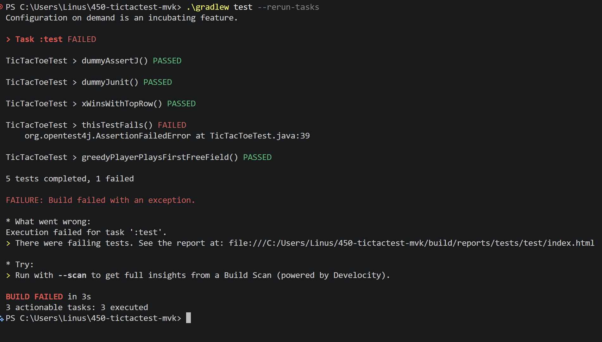

# Testdokumentation – TicTacToe (M450)

## Setup

`build.gradle`:

```groovy
dependencies {
    testImplementation 'org.assertj:assertj-core:3.27.7'
    testImplementation 'org.junit.jupiter:junit-jupiter:6.1.3'
    testRuntimeOnly 'org.junit.platform:junit-platform-launcher'
}

test {
    useJUnitPlatform()
    finalizedBy jacocoTestReport
}
```

`junit-jupiter` ist das Aggregat-Artefakt und enthält `junit-jupiter-params` bereits – für `@ParameterizedTest` braucht es keine zusätzliche Dependency.

Ausführen: `./gradlew test --rerun-tasks`. Danach liegt der Coverage-Report unter `build/reports/jacoco/test/html/index.html`.

## Test-Code auf GitHub

<https://github.com/Flashbibi/450-tictactest-mvk/tree/main/src/test/java/ch/bbw/m450/tictactoe>

## Hilfsstrukturen

| Baustein | Wo | Wofür |
|---|---|---|
| `boardOf(sketch)` | `Boards.java` | baut ein `Stone[]` aus einer lesbaren Skizze wie `"XXX ... ..."` (`X` = Kreuz, `O` = Kreis, `.` = leer) |
| `assertThatBoard(...)` | `BoardAssert.java` | eigene AssertJ-Assertion: `assertThatBoard("XXX ... ...").isWonBy(CROSS)` statt `assertThat(isWin(...)).isTrue()` |
| Fixture `setUp()` | `TicTacToeTest` | baut vor jedem Test ein frisches Board aus `DRAW_BOARD` (`"XXO OOX XOX"`, volles Brett ohne Sieger) |
| `playing(0, 1, 2)` | `TicTacToeTest` | Test-Double für einen Spieler: spielt die angegebenen Felder der Reihe nach. Ein Lambda, kein Mocking-Framework |

## Tests (GIVEN_WHEN_THEN)

### `TicTacToeTest` – Siegerkennung `isWin`

| Test | GIVEN | WHEN | THEN |
|---|---|---|---|
| `nobodyWinsTheDrawBoard` (2 Fälle) | das Fixture-Board `XXO / OOX / XOX` | `isWin` für `CROSS` und für `CIRCLE` | niemand gewinnt |
| `detectsWinningLine` (8 Fälle) | je eine der 8 Gewinnlinien (3 Zeilen, 3 Spalten, 2 Diagonalen), abwechselnd mit `CROSS` und `CIRCLE` | `isWin` für die Farbe der Linie und für den Gegner | die Farbe der Linie gewinnt, der Gegner nicht |
| `detectsNoWinningLine` (3 Fälle) | ein leeres Board, ein Board mit nur zwei in einer Reihe, ein Board mit `XXX` oben, abgefragt für `CIRCLE` | `isWin` | kein Sieg – die Erkennung ist farbabhängig und braucht drei in einer Linie |
| `twoInALineIsNoWin` (24 Fälle) | jede der 8 Linien mit nur zwei Steinen, jeder der drei Steine fehlt einmal | `isWin` für beide Farben | kein Sieg. So wird jede Teilbedingung in `isWin` einmal falsch |

### `TicTacToeTest` – Ausgabe `toString`

| Test | GIVEN | WHEN | THEN |
|---|---|---|---|
| `showsStonesAndTheNumbersOfFreeFields` | Board `XO. ..X O..` | `toString` | drei Zeilen, Steine als `X`/`O`, freie Felder als ihre Nummer |
| `printsStonesBoldAndFreeFieldsGray` | Board `XO. ... ...` | `toString` | Steine stehen fett (`\033[1m`), freie Felder grau (`\033[37m`) |

### `TicTacToeTest` – Spielschleife `play`

| Test | GIVEN | WHEN | THEN |
|---|---|---|---|
| `crossWinsWithTheTopRow` | X spielt 0, 1, 2 – O spielt 3, 4 | `play` | `CROSS` gewinnt |
| `circleWinsWithTheMiddleRow` | X spielt 0, 1, 8 – O spielt 3, 4, 5 | `play` | `CIRCLE` gewinnt |
| `fullBoardWithoutLineIsADraw` | Züge, die das `DRAW_BOARD` ergeben | `play` | Unentschieden, Rückgabe `null` |
| `rejectsMovesOutsideTheBoard` (2 Fälle) | X spielt auf Feld -1 bzw. 9 | `play` | `IllegalStateException` „cannot play to position …" |
| `rejectsMovesOnATakenField` | X und O spielen beide auf Feld 0 | `play` | `IllegalStateException` „cannot play to position 0" |
| `aPlayerCannotPlayAgainstItself` | derselbe Spieler als X und O | `play` | `IllegalArgumentException` „players must differ" |

### `TicTacToePlayerTest` und `GreedyPlayerTest`

| Test | GIVEN | WHEN | THEN |
|---|---|---|---|
| `opponentIsTheOtherColor` (2 Fälle) | `CROSS` bzw. `CIRCLE` | `opponent()` | die andere Farbe |
| `playsTheFirstFreeField` (4 Fälle) | Boards, auf denen das erste freie Feld 0, 2, 6 bzw. 8 ist | `GreedyPlayer.play` | genau dieses Feld |
| `givesUpOnAFullBoard` | ein volles Board | `GreedyPlayer.play` | `IllegalStateException` „cannot play at all" |

## Ergebnis

53 Testfälle, alle grün. JaCoCo: Branch Coverage 100 %, Instruction Coverage 91.5 %. Nicht abgedeckt sind `main(...)` und `HumanPlayer`, weil sie von der Tastatur lesen.

## Screenshot

Fehlschlag des Tests `thisTestFails` aus dem vorherigen Auftrag. Der Test ist inzwischen entfernt.


